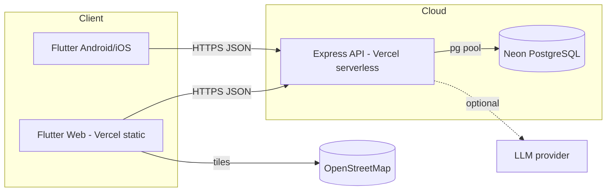
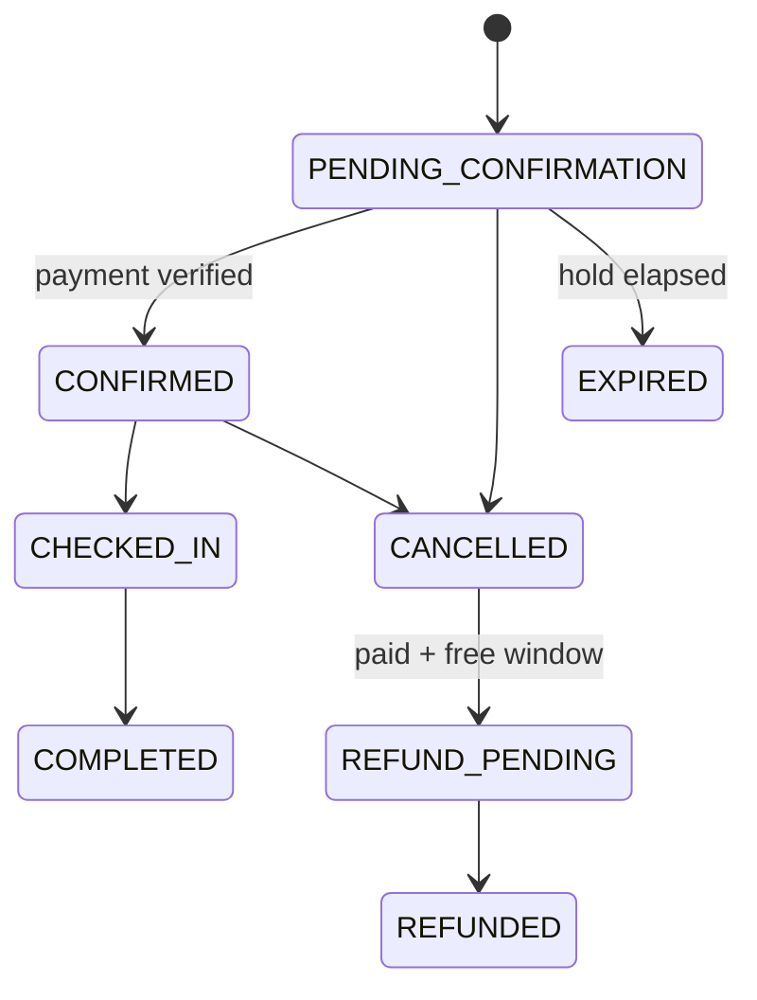

# Architecture

- **Client:** Flutter, Riverpod providers (cached async data keyed by query objects), go_router with auth redirects, Dio client with single-flight refresh on 401, tokens in secure storage.
- **API:** Express 5, zod validation, JWT (15 min) + rotating refresh tokens, Helmet, CORS, rate limits, uniform error envelope.
- **DB access:** `Db` adapter over `pg` (Neon) or in-process PGlite for dev/tests, with identical SQL.
- **Serverless note:** no background workers; booking holds are expired lazily on access.
- **AI:** `services/llm.ts` provider abstraction; `planner.ts` always retrieves from DB and validates LLM output with zod; fallback is deterministic.

## Booking state machine

`DRAFT` exists in the enum/transition table but the API creates bookings directly in `PENDING_CONFIRMATION`.

## Payment state machine
`PENDING -> SUCCESS | FAILED | CANCELLED`, `SUCCESS -> REFUNDED`.
