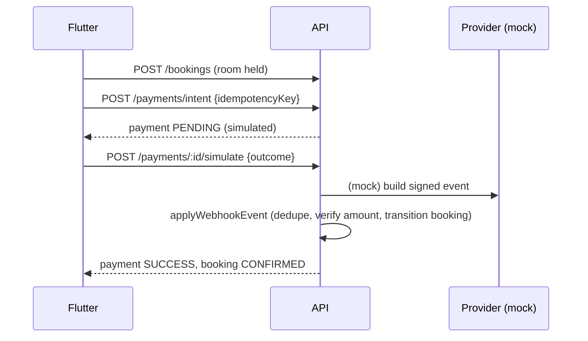

# Payment architecture

- The client never sends "paid". Only a verified event changes payment/booking state.
- Real provider integration: implement `createCharge`/webhook verification in `services/payment.ts` and set `PAYMENT_PROVIDER_MODE`; the `/payments/webhook` route already verifies an HMAC over the raw body.
- Idempotency: unique `idempotency_key`; duplicate provider events ignored; amount mismatch fails the payment; payments for non-payable bookings fail.
- Everything is flagged `simulated` and receipts print "SIMULATED PAYMENT - no real money was transferred".
